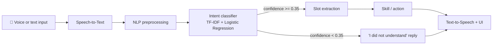

# 🎙️ AI Voice Assistant (NLP & Speech Processing)


A Python voice assistant that **listens**, **understands** what you want using NLP, **acts**, and **talks back**.
It has a modern web interface (animated orb + chat) and also runs in the terminal.
Everything uses free, open-source tools. No paid API key is needed.

<!-- After you add your screenshot, delete this line and uncomment the next one:

-->

## ✨ Features
- 🎤 Voice commands (browser or Python microphone) and typed commands
- 🧠 NLP intent classifier (TF-IDF + Logistic Regression) with a confidence threshold
- 🔎 Slot extraction: pulls the useful part out of a sentence ("search *python tutorials* on google")
- ⚙️ 15 intents: time, date, Google search, Wikipedia answers, open websites/apps, YouTube, calculator, jokes, notes, small talk
- 🔊 Spoken replies (browser speech synthesis in the UI, `pyttsx3` offline in the terminal)
- 🖥️ Animated web UI that reacts while listening, thinking and speaking, and shows the detected intent + confidence
- 🛡️ Safe calculator (uses `ast`, never `eval`) and graceful fallbacks when libraries or the microphone are missing

## 🧩 How it works

1. **Speech-to-text:** the browser (Chrome/Edge) or the Python microphone code converts speech to text.
2. **Preprocessing:** lowercase, remove punctuation, replace numbers with one token.
3. **Intent classification:** TF-IDF features + Logistic Regression predict what the user wants.
4. **Confidence threshold:** weak predictions are rejected instead of triggering a wrong action.
5. **Slot extraction:** regex rules extract the query, topic, app name or note text.
6. **Skill:** the matching function runs (search, Wikipedia, calculator, ...).
7. **Reply:** shown in the chat and spoken aloud.

## 🛠️ Tech stack
| Area | Tools |
|---|---|
| Language | Python 3.10+ |
| NLP / ML | scikit-learn (TfidfVectorizer, LogisticRegression) |
| Speech | SpeechRecognition (Google Web Speech API), sounddevice / PyAudio, pyttsx3, browser Web Speech API |
| Web | FastAPI, Uvicorn, HTML/CSS/JavaScript |
| Extras | wikipedia, pyjokes |

## 📁 Project structure
```
ai-voice-assistant/
├── main.py                  # terminal entry point (voice or text mode)
├── web_app.py               # FastAPI server for the web UI
├── static/index.html        # web UI (animated orb, chat, mic button)
├── assistant/
│   ├── nlp.py               # preprocessing, intent classifier, slot extraction
│   ├── skills.py            # the action behind every intent
│   └── speech.py            # speech-to-text and text-to-speech
├── data/intents.json        # training phrases for each intent
├── notebooks/AI_Voice_Assistant.ipynb  # step-by-step notebook with saved outputs and charts
├── tests/test_intents.py    # evaluation on unseen phrases
├── docs/CODE_EXPLANATION.md # detailed walkthrough of the code
├── requirements.txt
└── LICENSE
```

## 🚀 Installation
```bash
git clone https://github.com/MuhammadAbdullahIkram/ai-voice-assistant.git
cd ai-voice-assistant
python -m venv venv
venv\Scripts\activate            # Windows   (Mac/Linux: source venv/bin/activate)
pip install -r requirements.txt
```

## ▶️ Usage
```bash
python web_app.py                # web UI (opens http://127.0.0.1:8000 automatically) (use Chrome or Edge, allow the microphone)
python main.py                   # terminal voice mode
python main.py --text --debug    # type commands and see intent + confidence (no microphone needed)
```
Options: `--mute` disables spoken replies.

### Example commands
| Say | What happens |
|---|---|
| "what time is it" / "what is today's date" | tells the time / date |
| "search python tutorials on google" | opens Google results |
| "who is Albert Einstein" | reads a Wikipedia summary |
| "open youtube" / "open notepad" | opens the website / Windows app |
| "play lofi music on youtube" | opens YouTube search results |
| "calculate 12 times 4" | "The answer is 48." |
| "take a note submit assignment" / "read my notes" | saves / reads notes |
| "tell me a joke", "help", "exit" | jokes, help, quit |

## 📊 Evaluation
```bash
python tests/test_intents.py
```
The intent classifier correctly identified **24 of 24 (100%)** hand-written phrases that are not in the training data,
and every prediction was above the confidence threshold. This is a small test set written by the author, so treat it as
a sanity check, not a benchmark. Real users will phrase things differently.

## ⚠️ Limitations
- Speech recognition needs an internet connection and works for English only.
- The intent model is trained on a small set of phrases, so unusual wording may be misunderstood.
- Opening desktop apps is Windows-specific.
- Accuracy of speech recognition depends on the microphone and background noise.

## 🔮 Future work
Offline speech recognition (Vosk), a wake word ("Hey assistant"), more skills (weather, reminders, email),
an LLM fallback (Claude API or local Ollama) for open-ended questions, and Urdu support.

## 📚 Learn more
Open [notebooks/AI_Voice_Assistant.ipynb](notebooks/AI_Voice_Assistant.ipynb) for the whole pipeline step by step, with outputs and charts.
See [docs/CODE_EXPLANATION.md](docs/CODE_EXPLANATION.md) for a file-by-file walkthrough and a tutorial on adding a new intent.

## 👤 Author
**Muhammad Abdullah**, Data Science graduate, University of Okara
[GitHub](https://github.com/MuhammadAbdullahIkram) · [LinkedIn](https://linkedin.com/in/muhammad-abdullah-394288242)

## 📄 License
MIT, see [LICENSE](LICENSE).

.png)
.png)
.png)
